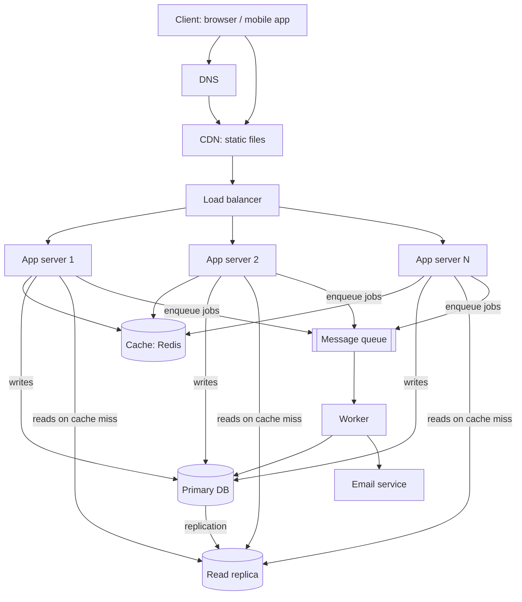

# QuickNotes Architecture

## Requirements

### Functional
- Users register, log in and log out.
- Users create, read, update and delete their own notes.
- Users tag notes and filter by tag.
- Notes sync across devices.
- Optional email notification (e.g. weekly digest) sent in the background.

### Non-functional
- **Scale:** support 1 million users.
- **Availability:** 99.9% uptime (about 9 hours downtime per year at most); no single point of failure.
- **Latency:** p95 under 300 ms for reads and writes.
- **Durability:** a saved note is never lost (replication and backups).
- **Security:** HTTPS everywhere, hashed passwords, users can only access their own data.
- **Consistency:** a user sees their own writes immediately; slight staleness on other reads is acceptable.

## Load estimate (1 million users)

Assumptions (stated so the team can adjust them): 1M registered users, each user per day makes 20 reads (opening the app, listing notes) and 2 writes (new or edited notes); average note about 1 KB; peak traffic is about 4x average.

| Metric | Calculation | Result |
|--------|-------------|--------|
| Reads/day | 1M x 20 | 20 million |
| Reads/second (avg) | 20M / 86,400 | ~230 /s |
| Reads/second (peak) | 230 x 4 | ~1,000 /s |
| Writes/day | 1M x 2 | 2 million |
| Writes/second (avg) | 2M / 86,400 | ~23 /s |
| Writes/second (peak) | 23 x 4 | ~100 /s |
| Storage/year | 2M x 365 x 1 KB | ~730 GB (about 0.7 TB) |
| With indexes + 2 replicas | ~730 GB x 1.5 index overhead x 3 copies | ~3.3 TB in total |

Read-to-write ratio is about 10:1, so caching and read replicas help a lot. One well-sized PostgreSQL primary handles ~100 writes/s easily; the design adds redundancy for availability rather than raw capacity.

## Architecture diagram



ASCII version:

```
Client -> DNS -> CDN (static)
Client -> Load Balancer -> App Server 1 / 2 / N
App servers -> Cache (Redis)
App servers -> Primary DB (writes) --replication--> Read Replica (reads)
App servers -> Queue -> Worker -> (DB / email)
```

## Why each component exists

- **Client:** the browser or mobile app that calls the REST API and shows notes to the user.
- **DNS:** turns `quicknotes.example` into the IP address of the CDN or load balancer, so users do not need to know server addresses and we can move servers without changing the name.
- **CDN:** serves HTML, CSS and JS from servers near the user, which cuts latency and keeps static traffic off our app servers.
- **Load balancer:** spreads requests across app servers and stops sending traffic to unhealthy ones, which removes the app tier as a single point of failure.
- **App servers (2 or more):** run the stateless API logic, so we can add more to scale horizontally and lose one without downtime.
- **Cache (Redis):** keeps recent note lists in memory so most reads avoid the database, which handles the 10:1 read-heavy load and lowers latency.
- **Primary database:** the single source of truth that accepts all writes with transactions and integrity constraints.
- **Read replica:** a live copy of the primary that serves read queries to offload the primary and can be promoted if the primary fails.
- **Message queue:** holds slow background jobs (emails, digests) so API requests return quickly and spikes are smoothed out.
- **Worker:** takes jobs from the queue and performs them (sending email, cleanup), isolated from user-facing request handling and retried if it fails.

## Request flows

### GET /notes
1. Client sends `GET /v1/notes?limit=10` with its token; DNS resolves the host.
2. The request reaches the load balancer (API calls are not cached by the CDN), which picks a healthy app server.
3. The app server validates the token and extracts the user id (401 if invalid).
4. It checks the cache with key `notes:{userId}:page1`.
5. **Cache hit:** return the cached JSON immediately (200).
6. **Cache miss:** query the read replica (`WHERE user_id = ... ORDER BY created_at DESC LIMIT 10`), store the result in the cache with a short TTL (e.g. 60 s), and return 200.

### POST /notes
1. Client sends `POST /v1/notes` with JSON body and token.
2. The load balancer routes it to an app server.
3. The app server authenticates the user and validates the body (title required, max 100 chars; else 400).
4. It writes the note (and tag links) to the **primary** database in one transaction.
5. It invalidates the user's cache keys (`notes:{userId}:*`) so the next read is fresh, giving read-your-own-writes.
6. It optionally enqueues a background job (e.g. notification) to the queue; a worker processes it later.
7. It returns `201 Created` with the new note and a `Location` header. The replica receives the change through replication within milliseconds.

## Trade-offs

1. **Cache freshness vs. speed.** A TTL cache can serve slightly stale data. We reduce this by invalidating on write and keeping TTLs short; the cost is some extra complexity and occasional cache misses after writes.
2. **Replica lag (eventual consistency) vs. read scalability.** Reads from the replica may lag the primary by milliseconds. We accept this for list views, but read from the primary (or rely on cache invalidation) right after a user's own write.
3. **SQL consistency vs. NoSQL horizontal scale.** SQL gives integrity and transactions but scaling writes needs sharding later; at ~100 writes/s that is unnecessary now.
4. **Queue = async simplicity vs. delivery delay.** Background jobs make the API fast but emails arrive seconds later and must be idempotent because retries can duplicate work.

## Avoiding single points of failure

- **DNS and CDN:** use a managed provider with multiple points of presence.
- **Load balancer:** run a redundant pair (or a managed, multi-zone load balancer) with health checks.
- **App servers:** at least two, in different availability zones, stateless so any can serve any request.
- **Cache:** Redis with a replica and automatic failover; if the cache is down, the app falls back to the database (slower but working).
- **Database:** the primary has a synchronous or near-synchronous standby; the read replica can be promoted. Daily backups plus point-in-time recovery protect against data loss.
- **Queue and worker:** a managed, replicated queue; run two or more workers; failed jobs are retried and moved to a dead-letter queue.
- **General:** deploy across multiple availability zones, monitor and alert on health.
