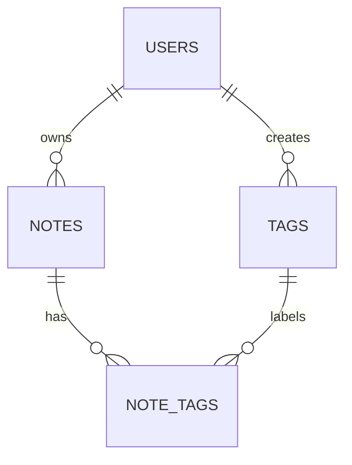

# QuickNotes Data Model

## Entities

### users
| Column | Type | Key / notes |
|--------|------|-------------|
| id | BIGINT | **PK**, auto increment |
| email | VARCHAR(255) | UNIQUE, NOT NULL |
| password_hash | VARCHAR(255) | NOT NULL |
| created_at | TIMESTAMP | NOT NULL, default now |

### notes
| Column | Type | Key / notes |
|--------|------|-------------|
| id | BIGINT | **PK**, auto increment |
| user_id | BIGINT | **FK** -> users.id, NOT NULL |
| title | VARCHAR(100) | NOT NULL |
| body | TEXT | nullable |
| created_at | TIMESTAMP | NOT NULL |
| updated_at | TIMESTAMP | NOT NULL |

### tags
| Column | Type | Key / notes |
|--------|------|-------------|
| id | BIGINT | **PK**, auto increment |
| user_id | BIGINT | **FK** -> users.id, NOT NULL |
| name | VARCHAR(50) | NOT NULL, UNIQUE per user |

### note_tags (join table)
| Column | Type | Key / notes |
|--------|------|-------------|
| note_id | BIGINT | **FK** -> notes.id, part of composite PK |
| tag_id | BIGINT | **FK** -> tags.id, part of composite PK |

## Relationships

- **One-to-many: users -> notes.** One user owns many notes; each note has exactly one owner (`notes.user_id`).
- **One-to-many: users -> tags.** Each user has their own set of tags (`tags.user_id`).
- **Many-to-many: notes <-> tags.** A note can have many tags and a tag can label many notes. A relational database cannot store this in one column, so the join table `note_tags` holds one row per (note, tag) pair.



## CREATE TABLE statements (PostgreSQL)

```sql
CREATE TABLE users (
  id            BIGSERIAL PRIMARY KEY,
  email         VARCHAR(255) NOT NULL UNIQUE,
  password_hash VARCHAR(255) NOT NULL,
  created_at    TIMESTAMP NOT NULL DEFAULT now()
);

CREATE TABLE notes (
  id         BIGSERIAL PRIMARY KEY,
  user_id    BIGINT NOT NULL REFERENCES users(id) ON DELETE CASCADE,
  title      VARCHAR(100) NOT NULL,
  body       TEXT,
  created_at TIMESTAMP NOT NULL DEFAULT now(),
  updated_at TIMESTAMP NOT NULL DEFAULT now()
);

CREATE TABLE tags (
  id      BIGSERIAL PRIMARY KEY,
  user_id BIGINT NOT NULL REFERENCES users(id) ON DELETE CASCADE,
  name    VARCHAR(50) NOT NULL,
  UNIQUE (user_id, name)
);

CREATE TABLE note_tags (
  note_id BIGINT NOT NULL REFERENCES notes(id) ON DELETE CASCADE,
  tag_id  BIGINT NOT NULL REFERENCES tags(id)  ON DELETE CASCADE,
  PRIMARY KEY (note_id, tag_id)
);
```

## Example queries

```sql
-- 1. Latest 10 notes of a user (the GET /notes query)
SELECT id, title, body, created_at
FROM notes
WHERE user_id = 17
ORDER BY created_at DESC
LIMIT 10;

-- 2. JOIN: all notes with the tag "work" for a user
SELECT n.id, n.title, t.name AS tag
FROM notes n
JOIN note_tags nt ON nt.note_id = n.id
JOIN tags t       ON t.id = nt.tag_id
WHERE n.user_id = 17 AND t.name = 'work'
ORDER BY n.created_at DESC;

-- 3. How many notes does each tag have?
SELECT t.name, COUNT(nt.note_id) AS note_count
FROM tags t
LEFT JOIN note_tags nt ON nt.tag_id = t.id
WHERE t.user_id = 17
GROUP BY t.name
ORDER BY note_count DESC;

-- 4. Delete a note (its note_tags rows go with it via ON DELETE CASCADE)
DELETE FROM notes WHERE id = 5021 AND user_id = 17;
```

## Indexes

```sql
CREATE INDEX idx_notes_user_created ON notes (user_id, created_at DESC);
CREATE INDEX idx_note_tags_tag ON note_tags (tag_id);
```

- `idx_notes_user_created`: the most common query is "latest notes for one user". Without it the database scans millions of rows; with it, it reads the first 10 entries of an already sorted index.
- `idx_note_tags_tag`: the composite PK already covers lookups by note; this index covers the reverse lookup "all notes with this tag" used in the JOIN query.

(`users.email` is already indexed through its UNIQUE constraint, which makes login fast.)

## SQL or NoSQL?

I choose **SQL (PostgreSQL)**. The data is clearly relational (users own notes, notes and tags are many-to-many), and I need integrity guarantees: foreign keys stop orphaned notes, unique constraints stop duplicate emails or tags, and transactions keep "create note + attach tags" all-or-nothing. The schema is stable and queries are predictable, so the flexibility of NoSQL is not needed. Scale is also not a problem: 1 million users is roughly a few hundred GB per year (see the architecture doc), which one primary with read replicas handles, and the data can later be sharded by `user_id` because every query is already scoped to one user.
